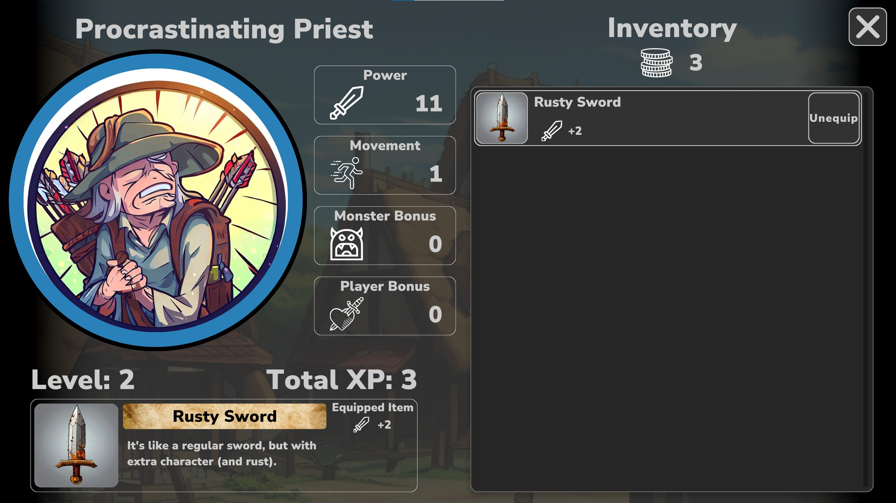

# Discount RPG Realm

A Unity/C# local multiplayer board-game prototype. Players take turns moving around a board, fighting monsters or other players, trading equipment, and completing minigames.

[Gameplay video and project overview](https://red-wave-026ab431e.3.azurestaticapps.net/rpg_realm)

## Systems

- Turn sequencing for players and monsters.
- Board movement and space-triggered encounters.
- Player-versus-player and player-versus-monster combat.
- Inventory, shops, equipment effects, and progression.
- Chance events and minigames, including Plinko.
- UI for player setup, actions, combat, and turn order.

## Code highlights

- [TurnManager](Assets/Scripts/TurnManager.cs) shuffles initial player order, maintains a turn queue, and triggers turn events.
- [CombatManager](Assets/Scripts/CombatManager.cs) resolves encounters using combat power and passes results to the battle UI and turn-state handlers.
- [TurnState](Assets/Scripts/TurnState.cs) and the begin/end handlers coordinate phases of a turn.
- ScriptableObject types such as [ItemSO](Assets/Scripts/ItemSO.cs), [MonsterSO](Assets/Scripts/MonsterSO.cs), and [SpaceSO](Assets/Scripts/SpaceSO.cs) define game content.

## Open the project

1. Clone this repository and add its root folder through Unity Hub.
2. Open with **Unity 2021.3.22f1**, the version recorded in `ProjectSettings/ProjectVersion.txt`.
3. Allow Unity to resolve packages.
4. Open `Assets/Scenes/Startup.unity` and enter Play mode. Build Settings also includes `Main Menu.unity` and `GameBoard.unity`.

This is a prototype source project. These instructions follow the checked-in Unity settings; the project has not been freshly built as part of this documentation update.

## Assets

Third-party assets remain subject to their respective licenses and are not presented as original work.
